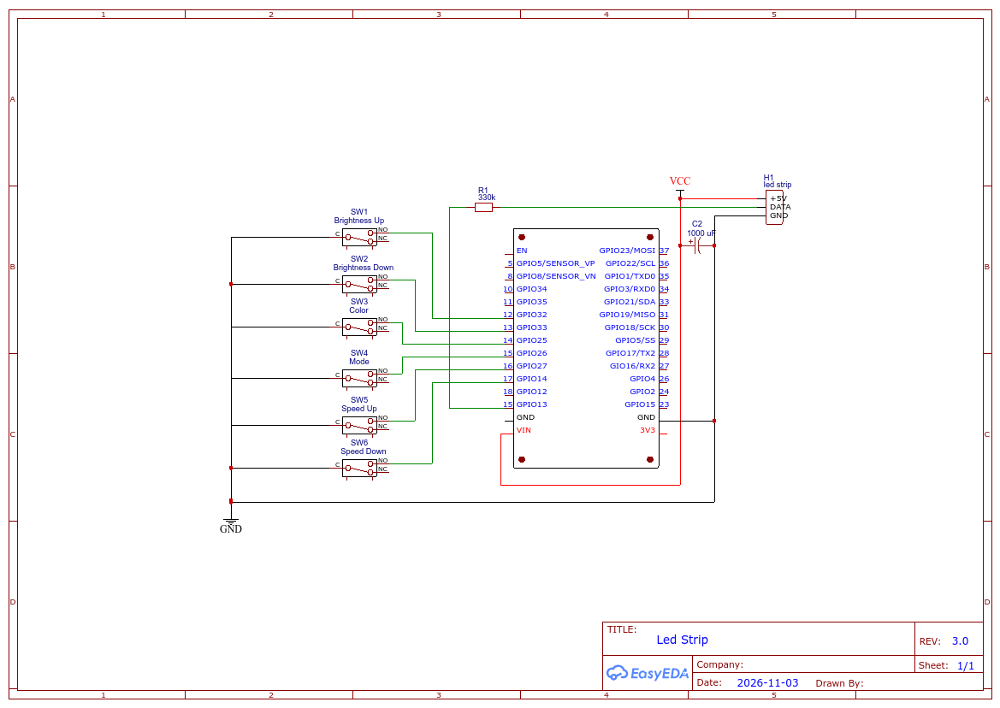

# 🎄 Christmas Garland 🎄

A Christmas LED garland project based on an ESP32, developed in C++ using ESP-IDF.

## Project Goal

The goal of this project is to create a programmable Christmas LED garland with custom lighting effects.

## Development

This project uses [ESP-IDF](https://github.com/espressif/esp-idf), Espressif's official development framework for ESP32 devices.

### Prerequisites

- [ESP-IDF](https://docs.espressif.com/projects/esp-idf/en/stable/esp32/get-started/index.html) installed and configured
- Visual Studio Code (optional)
- An ESP32 development board

## Project Structure

The following tree shows the main directory structure of the project:

```text
.
├── CMakeLists.txt
├── dependencies.lock
├── docs
│   └── wiring_diagram.png
├── main
│   ├── animation.cpp
│   ├── christmas_garland.cpp
│   ├── christmas_garland.h
│   ├── CMakeLists.txt
│   └── listeners.cpp
├── README.md
└── sdkconfig
```

Only the main directories and files are shown for clarity. Build files, cache directories, and generated files are omitted.

## Hardware

- ESP32 development board
- Addressable LED strip with 60 LEDs x2 (WS2812B)
- Slide switch for power control

### Power Supply

- **Default:** 5 V USB power adapter connected via the ESP32 Micro-USB port.
- **Optional:** 5 V rechargeable battery with a regulated USB output.
- **LED strip:** Powered via the ESP32 VIN pin.

The electronic schematic is available here:



### ESP32 Pin Configuration

| ESP32 Pin | Function    | Description                              |
|-----------|-------------|------------------------------------------|
| GPIO 13   | LED Data    | Sends control data to the LED strip      |
| GPIO 14   | Brightness  | Adjusts the brightness of the LEDs       |
| GPIO 27   | Color       | Selects the LED color                    |
| GPIO 26   | Mode        | Selects the lighting pattern (e.g.       |
|           |             | snake, rainbow, etc.)                    |
| GPIO 25   | Speed       | Adjusts the speed of the lighting effect |

## Software

### Button Controls

Each of the four control buttons runs in its own FreeRTOS task (thread), allowing the controls to operate independently.

- **LED Controller Task**: Controls the LED strip and runs the lighting animations.
- **Brightness Button Listener**: Adjusts LED brightness.
- **Color Button Listener**: Changes the LED color.
- **Mode Button Listener**: Selects the lighting pattern (e.g., snake, rainbow, etc.).
- **Speed Button Listener**: Adjusts the speed of the lighting effects. 

## Build & Flash

Activate the ESP-IDF environment:
*   ```bash
    source "$HOME/.espressif/v6.1/esp-idf/export.sh"
    ```

Build / Flash the project:
*   ```bash
    idf.py build
    ```
*   ```bash
    idf.py -p /dev/ttyXXX flash
    ```

Display serial output:
*   ```bash
    idf.py monitor
    ```
    *Ctrl + ] - to exit the monitor*

Both:
*   ```bash
    idf.py flash && idf.py monitor
    ```

Clean the project, delete build output files or entire build directory:
*   ```bash
    idf.py -p /dev/ttyXXX flash
    ```
*   ```bash
    idf.py fullclean
    ```

## References & Resources

Useful documentation and resources that helped during the development of this project.

- [ESP-IDF Programming Guide](https://docs.espressif.com/projects/esp-idf/en/stable/esp32/index.html) - Official ESP-IDF documentation.
- [ESP32 Datasheet](https://www.espressif.com/sites/default/files/documentation/esp32_datasheet_en.pdf) - ESP32 technical specifications.
- [ESP32 GPIO](https://docs.espressif.com/projects/esp-idf/en/stable/esp32/api-reference/peripherals/gpio.html) - ESP32 GPIO
- [ESP32 API LED Strip](https://espressif.github.io/idf-extra-components/latest/led_strip/index.html#allocate-led-strip-object-with-rmt-backend) - ESP32 API LED Strip
- [FreeRTOS with Espressif](https://docs.espressif.com/projects/esp-idf/en/v4.3/esp32/api-reference/system/freertos.html) - FreeRTOS with Espressif
- [FreeRTOS](https://www.freertos.org/Documentation/02-Kernel/04-API-references/10-Semaphore-and-Mutexes/06-xSemaphoreCreateMutex) - FreeRTOS Semaphore
- [FreeRTOS](https://www.freertos.org/Documentation/02-Kernel/04-API-references/05-Direct-to-task-notifications/03-ulTaskNotifyTake) - FreeRTOS TaskNotify


